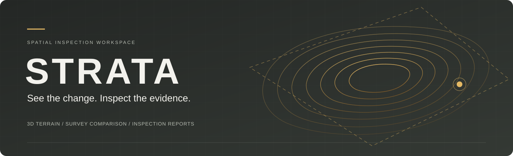

<p align="center">
  <strong>3D Mine Boundary Inspector</strong><br/>
  A spatial inspection workspace connecting excavation changes to reviewable evidence.
</p>

<p align="center">
  <kbd>React 19</kbd> &nbsp; <kbd>TypeScript</kbd> &nbsp; <kbd>Three.js</kbd> &nbsp; <kbd>Local-first</kbd> &nbsp; <kbd>PDF evidence</kbd>
</p>

<p align="center">
  <a href="#the-inspection-workflow">Walkthrough</a> ·
  <a href="#run-it-locally">Quick start</a> ·
  <a href="#built-for-spatial-inspection">Features</a> ·
  <a href="TECH_STACK.md">Architecture</a> ·
  <a href="ROADMAP.md">Roadmap</a>
</p>

---

## From a changed surface to a clear finding

Mining inspectors need to understand **where excavation changed, which configured limit it crossed, and what needs verification**. STRATA brings that information together in an interactive 3D workspace.

Explore a terraced mine, compare two surveys, inspect footprint and depth exceedances, examine a cross-section, and export the evidence behind a finding.

Built for government mining inspectors and officials as a **TechnoXian NRC innovation project in Noida, India**.


<p align="center"><em>Actual application screenshot · generated mine geometry · calculated inspection findings</em></p>

## Built for spatial inspection

| Capability                   | What it helps you do                                                               |
| ---------------------------- | ---------------------------------------------------------------------------------- |
| **Explore in 3D**            | Understand benches, access ramps, terrain and the permitted footprint in one view. |
| **Compare surveys**          | Reveal where the surveyed ground changed between two dates.                        |
| **Review boundary findings** | Locate excavation outside the configured permitted footprint.                      |
| **Inspect depth**            | Distinguish elevation, excavation depth and depth-limit exceedance.                |
| **Slice the terrain**        | Compare survey profiles and permitted elevation along a selected section.          |
| **Record a decision**        | Save inspector notes and review status separately from the calculation.            |
| **Export evidence**          | Download a dated PDF with measurements, methods, provenance and review notes.      |

### A detailed site, with measurements behind the view

- **720,000 terrain triangles** across a **601 × 601 vertex grid**.
- **4 m surface spacing** shared by the terrain viewer and measurement tools.
- Irregular benches, a carved access ramp, rock strata and directional shadows.
- Separate exposed-rock and exterior soil/gravel materials, bundled locally.
- Haul trucks, buildings, stockpiles, boulders and vegetation for scale.
- Smooth camera focus, top view, camera reset and a live rendering indicator.

## The inspection workflow

**Overview → Compare → Reveal → Inspect → Review → Export**

1. **Start with the site.** Open the overview dashboard and enter the mine.
2. **Establish the baseline.** Select **A · 15 Sep 2026**; the configured baseline has no sampled exceedances.
3. **Reveal the change.** Switch to **B · 15 Oct 2026**, then choose **Survey change**.
4. **Follow the evidence.** Select **Footprint exceedance** to focus on the affected excavation and its measurements.
5. **Inspect below the surface.** Open **Inspect cross-section**, or select two terrain points with the section tool. Review the separate **Depth exceedance** finding.
6. **Leave a usable record.** Add a review status and note, then export **Report** from the explorer to include the current terrain image.

## Run it locally

Use **Node.js 24 LTS**. Development was verified with **Node 24.19.0** and **npm 11.17.0**.

```sh
git clone https://github.com/pranav-5412/strata-mine-inspector.git
cd strata-mine-inspector
npm ci
npm run dev
```

Open the local URL printed by Vite. No API key, map subscription, cloud database or app account is required. The initial dependency installation requires internet.

### Production preview

```sh
npm run build
npm run preview -- --port 4173 --strictPort
```

Open **http://127.0.0.1:4173/**.

**On Windows:** after installation and the first build, double-click **Start STRATA.cmd**. Keep its terminal running. If this project is already serving port 4173, use that instance.

> **Local-first operation:** application assets, icons and materials are bundled locally. Notes stay in the selected browser and origin; clearing its storage removes them. Export a PDF to preserve a readable record. A disconnected-network judging rehearsal remains a preparation milestone.

## Under the hood

| Layer          | Choice                                                    |
| -------------- | --------------------------------------------------------- |
| Interface      | React 19 · TypeScript · Vite 7                            |
| 3D scene       | Three.js · React Three Fiber 9 · Drei 10                  |
| Presentation   | Custom responsive CSS · Lucide React                      |
| Monitoring     | Independent TypeScript grid and polygon calculations      |
| Evidence       | jsPDF · browser localStorage                              |
| Quality checks | Vitest · TypeScript build · Prettier · browser inspection |

Dependencies are pinned by `package-lock.json`. The [architecture document](TECH_STACK.md) explains the site data contract and rendering choices.

<details>
<summary><strong>Explore the source structure</strong></summary>

```text
src/
  App.tsx             Dashboard, inspection workflow and review state
  model.ts            Site generation, surface sampling, findings and profiles
  model.test.ts       Numerical fixtures and ramp-continuity checks
  MineScene.tsx       Terrain mesh, camera, lighting and overlays
  MineDetails.tsx     Access-ramp ribbon, scatter, equipment and buildings
  rockMaterial.ts     Rock and exterior-ground material blending
  SectionChart.tsx    Survey cross-section chart
  report.ts           PDF evidence generation
  styles.css          Responsive interface styling
public/materials/     Locally bundled terrain textures
docs/images/          Project banner and application screenshots
```

</details>

<details>
<summary><strong>Understand the measurement method</strong></summary>

The viewer and measurement tools share the same triangle-interpolated elevation grid. Findings use **4 m cell-centre sampling**, a configured polygon and a **2 m vertical tolerance**. Connected flagged cells form review findings.

| Measurement       | Definition                                                    |
| ----------------- | ------------------------------------------------------------- |
| Elevation         | Height relative to the site's local vertical reference.       |
| Excavation depth  | Reference ground minus surveyed elevation.                    |
| Depth exceedance  | Permitted elevation minus surveyed elevation, where positive. |
| Footprint finding | Excavation outside the permitted polygon above tolerance.     |

Area and volume estimates depend on sampling resolution. Finding types can overlap, so their areas and volumes must not be added as unique totals. Texture detail does not displace the measured mesh. Inspector decisions do not alter calculated findings.

The current permitted depth surface is horizontal at **−155 m**. A real approved mine plan may require a varying surface.

</details>

## Verification

```sh
npm test
npm run build
npm run format:check
```

**11 numerical tests** cover interpolation, missing/outside coverage, polygon edges, untouched ground, known area/volume, tolerance, generated findings, section endpoints, surface resolution and ramp continuity.

Browser checks include the compliant baseline, calculated breaches, selected measurements, cross-sections, saved notes, PDF download and material rendering. Results and remaining checks are recorded in [VERIFICATION.md](VERIFICATION.md).

## Project status and next steps

**Current stage: working prototype.** Aravalli Open-Pit is a generated site with controlled survey scenarios, allowing the detection workflow to be checked against known changes.

Next milestones:

- Refine exported reports and include selected cross-section evidence.
- Complete accessibility, error-recovery and repeated offline walkthrough checks.
- Import validated survey data and authoritative boundaries for a real Indian mine.

The present model is not a surveyed Indian mine, a live monitoring installation or a regulatory determination. Real deployment needs fresh aligned surveys, verified coordinate/elevation references and appropriate data permissions. Slope-failure prediction and haul-road certification are outside this prototype's scope.

## Project documentation

| Document                                       | Inside                                                         |
| ---------------------------------------------- | -------------------------------------------------------------- |
| [Architecture](TECH_STACK.md)                  | Stack, data contract, rendering and implementation limits.     |
| [Verification record](VERIFICATION.md)         | Completed checks and pending validation.                       |
| [Competition roadmap](ROADMAP.md)              | Milestones, walkthrough and acceptance criteria.               |
| [Asset provenance](ASSETS.md)                  | Generated rock texture and its exact prompt.                   |
| [Exterior material](docs/EXTERIOR_MATERIAL.md) | Mine-ground references, generation prompt and blending method. |

---

**Source availability:** this repository is public. No open-source license has been selected for the project source. Dependency licenses remain with their respective authors. Generated material provenance is documented above.
