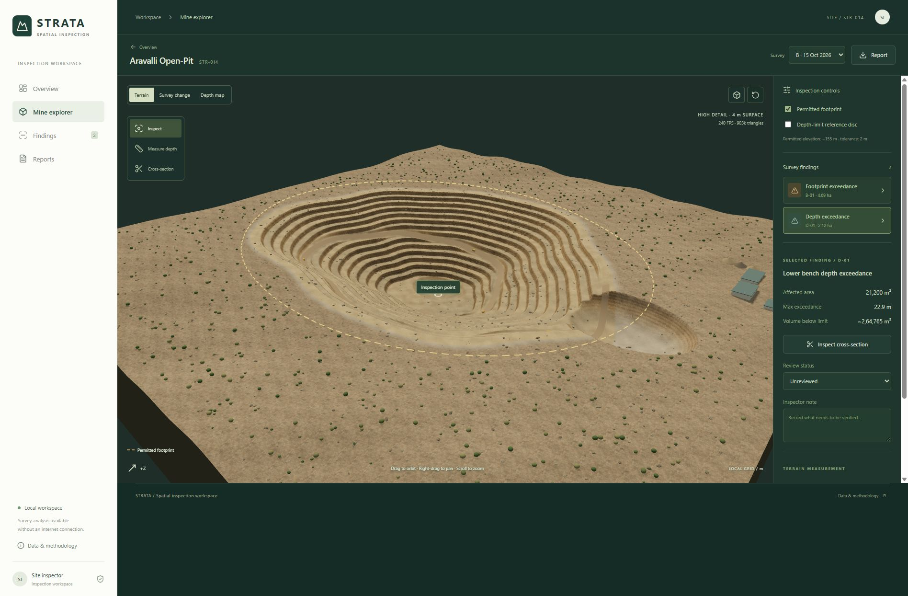

# Exterior mine-ground material

## Visual references

- [Ministry of Coal / PIB, Gevra and Kusmunda photographs, 18 July 2024](https://coal.gov.in/sites/default/files/2024-07/PIB2034007.pdf).
- [Original PIB release](https://www.pib.gov.in/PressReleasePage.aspx?PRID=2034007).

Reference direction: disturbed operational ground surrounding the excavation, with grey-brown soil, crushed gravel and dusty patches. The generated material is an artistic interpretation; reference photographs are neither copied nor bundled into the app.

## Asset and integration

Saved asset: `public/materials/mine-ground-v1.png`. Generated with the built-in image-generation tool on 16 October 2026.

The original `weathered-rock-v1.png` remains in use inside the excavation. An exterior vertex weight follows the generated terrain's pit radius and the reference-to-survey excavation depth, not its permitted footprint. This prevents the exterior material from replacing exposed rock in the separate breach excavation. The rim uses a soft transition. Ground sampling combines two texture scales/orientations and low-frequency tonal variation to reduce repetitive tiling.

The natural-terrain material blends soil/gravel onto unexcavated surroundings. Analytical layers retain their previous colour calculations. Texture detail does not move vertices or modify survey elevations, findings, measurements or cross-sections. Both material assets are bundled locally.

## Final generation prompt

> Use case: photorealistic-natural. Asset type: seamless square ground albedo texture for the OUTSIDE surface surrounding a generated Indian open-pit mine, distinct from the layered exposed rock inside the pit. Visual reference direction: disturbed mine surroundings and compacted operational ground visible in official Ministry of Coal aerial photographs of Gevra and Kusmunda (July 2024), used only for general material character, not reproducing their images. Primary request: an extremely realistic overhead orthographic scan of dry hard-packed grey-brown earth mixed with crushed angular gravel, fine mineral dust, weathered silt, a few subdued darker mineral-fines patches, light beige dust veils, irregular mottled compacted areas and very faint broken tyre abrasion. Neutral taupe, muted warm grey and dusty brown; no green cast, no bright yellow sand. Fine heterogeneous granularity, predominantly soil with small scattered embedded crushed stones, subdued tonal contrast, no large individual boulders. Tile represents approximately 30–50 metres of disturbed ground, with variation at multiple scales. Uniform diffuse lighting suitable for albedo, no perspective, horizon, directional cast shadows or vignette. Seamless repeatable edges and consistent density across the frame; no giant rocks, sedimentary wall layers, brickwork, cobblestones, road markings, dramatic cracks, vegetation, grass, buildings, vehicles, labels, borders, watermark or text. Fill the entire image with flat ground material. Highest practical resolution, square format.
